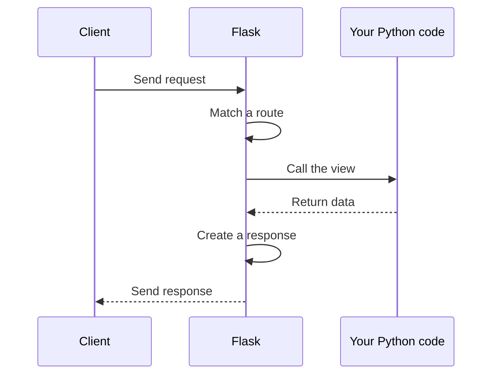

# A Simple Introduction to Flask

Flask is a Python library for building HTTP servers. These notes explain how a
Flask application starts, how it handles requests, and how it can put an HTTP
interface around existing Python objects.

The examples come from two runnable demonstrations:

| Demonstration                                                                | What it shows                                                  |
| ---------------------------------------------------------------------------- | -------------------------------------------------------------- |
| [Minimal echo server](../demo/flask_minimal_demo/demo_server.py)             | The smallest object-oriented Flask app: one route echoes JSON. |
| [Music library server](../demo/music_library_server/music_library_server.py) | A JSON API that wraps an existing `MusicLibrary` object.       |

The code snippets are abbreviated excerpts. Open the linked files for the
complete code.

---

## 1. What Flask Does

### What?

A command-line program runs, prints its results, and exits. A server keeps
running. It listens on an IP address and port, waits for requests from clients,
and sends a response to each one.

Flask handles the HTTP side of the server. Your Python code does the work:



### Why?

An administrator can request information from a host, such as its status or an
inventory, without logging in to that host. The same Python classes can serve
both a command-line interface and an HTTP interface. The work happens on the
computer running the server, not on the client.

### Key Concepts and Objects

| Concept or object   | What it does                                                                                       |
| ------------------- | -------------------------------------------------------------------------------------------------- |
| `Flask` application | Holds the configuration and the registered routes.                                                 |
| Route               | Connects a URL path and HTTP method to a handler.                                                  |
| Handler             | A function or method that receives and processes an event or request.                              |
| View                | A Flask request handler, written as a function or bound method.                                    |
| `request` object    | Gives a view access to the current HTTP request, including its JSON body and query parameters.       |
| `Response` object   | Holds the body, status code, and headers sent to the client. Flask builds it from a view's result. |
| `jsonify()`         | Creates a JSON `Response` from Python data.                                                        |
| Application factory | A function that builds and returns a configured Flask application.                                 |
| Development server  | A simple server that runs a Flask application on your own computer.                                |

A view does not have to display a web page. In a JSON API, it returns data.

---

## 2. How a Flask Application Starts

### What?

Starting a Flask application has two separate steps:

1. Build the application: create a `Flask` object and register its routes.
1. Run a server: listen on a port and pass each request to the application.

Building the application does not start a server. Keeping the steps separate
lets the same application be started by the Flask command line interface (CLI),
by `main()`, or by a production server.

### Building the Application with a Factory

An application factory is a function that builds and returns a `Flask` object.
Both demonstrations name it `create_app`.

The echo server's factory:

```python
def create_app() -> Flask:
    """Build the application for the Flask CLI or tests."""
    return EchoServer().app
```

The music server's factory:

```python
def create_app(library: MusicLibrary | None = None) -> Flask:
    """Build an application for the Flask CLI, production servers, or tests."""
    if library is None:
        library = build_seed_library()
    return MusicLibraryServer(library).app
```

Each factory creates a wrapper object and returns the `Flask` application it
holds. `EchoServer` and `MusicLibraryServer` _contain_ a Flask application; they
do not inherit from `Flask`. The music factory uses four sample tracks unless
the caller, such as a test, supplies its own library.

Inside each wrapper's `__init__`, `Flask(__name__)` creates the application.
The module name helps Flask locate the application's files.

### Running the Development Server

Each demonstration can be started in two ways. Run these commands from the
demonstration's folder:

| Method         | Echo server command                          | What happens                                                                        |
| -------------- | -------------------------------------------- | ----------------------------------------------------------------------------------- |
| Flask CLI      | `uv run flask --app demo_server run --debug` | Flask imports `demo_server`, finds and calls `create_app()`, and starts the server. |
| Run the module | `uv run python demo_server.py`               | Python runs the file directly, so `main()` calls `create_app().run(debug=True)`.    |

For the music server, replace `demo_server` with `music_library_server`.

Both modules end with the same startup code:

```python
def main():
    """Launch the Flask development server in debug mode."""
    create_app().run(debug=True)


if __name__ == "__main__":
    main()
```

`__name__` is `"__main__"` only when the file is run directly. When the Flask
CLI or a test imports the module, `main()` is not called, so importing the
module does not start a second server.

When started with the Flask CLI, the application starts in this order:

1. The CLI imports the module named by `--app`.
1. It calls `create_app()`.
1. The factory creates the wrapper object. Its `__init__` creates the `Flask`
   application and registers the routes.
1. The development server starts listening on `http://127.0.0.1:5000`.
1. The server handles requests until you stop it with `Ctrl+C`.

`--debug` and `debug=True` turn on debug mode. The server restarts when you save
a Python file, and an unhandled error shows a traceback in the browser.

### The Server, Flask, and WSGI

The web server handles network communication. Flask matches requests to views
and builds responses; views can call the Python objects that do the
application's work.

| Layer           | Responsibility                               | Provided by      |
| --------------- | -------------------------------------------- | ---------------- |
| Client          | Sends requests and receives responses.       | User or code     |
| Web server      | Handles network communication.              | Werkzeug in development |
| Flask app       | Matches routes, calls views, builds responses. | Flask            |
| Views and objects | Handle requests and application work.      | You write or reuse them |

Flask follows WSGI (Web Server Gateway Interface), a standard interface
between a Python web application and a web server. Because Flask follows this
standard, the same application can run with different WSGI servers. You do not
need to use WSGI directly.

| Environment | Server   | Start command |
| ----------- | -------- | ------------- |
| Development | Werkzeug | Use the Flask CLI command above. |
| Production  | Waitress | `waitress-serve --call music_library_server:create_app` |

Use the development server only for local learning. Do not expose it or its
interactive debugger to a network; production needs a production server and
appropriate configuration.

### Official Documentation

- [Application factories](https://flask.palletsprojects.com/en/stable/patterns/appfactories/)
- [Application discovery and the CLI](https://flask.palletsprojects.com/en/stable/cli/#application-discovery)
- [`Flask.run()`](https://flask.palletsprojects.com/en/stable/api/#flask.Flask.run)
- [PEP 3333 — Python WSGI Specification](https://peps.python.org/pep-3333/)

---

## 3. How a Flask Application Handles a Request

### What?

While the server runs, every request follows the same steps:

1. The server receives an HTTP request and passes it to Flask.
1. Flask matches the request's URL path and HTTP method against the registered
   routes.
1. Flask calls the matching view. While the view runs, `request` refers to this
   request.
1. The view returns a value, and Flask converts it into a `Response`.
1. The server sends the response and waits for the next request.

If no route matches the path, Flask returns `404 Not Found`. If the path matches
but the method does not, Flask returns `405 Method Not Allowed`. For example,
opening `/api/echo` in a browser sends `GET`, but that route only accepts
`POST`.

The application and its wrapper object are created once and handle every
request. Data stored in the wrapper stays between requests. Tracks added to the
music server remain until the server stops.

### Registering Bound Methods as Views

Both demonstrations register their views in the wrapper's `__init__`:

```python
self.app = Flask(__name__)
self.app.add_url_rule("/api/echo", view_func=self.echo, methods=["POST"])
```

1. `add_url_rule()` connects the path and methods to a view.
1. `self.echo` is a _bound method_: it is tied to this `EchoServer` object, so
   Flask can call it without supplying `self`. The view can use the object's
   attributes, such as the music server's `self.library`.
1. Pass `self.echo`, not `self.echo()`. The first gives Flask a method to call
   for each request; the second calls the method once during setup.
1. Without a `methods` argument, a route accepts `GET`.

### The Decorator Alternative

Many Flask examples register module-level functions with the `@app.route()`
decorator. This adapted example is not from the demonstrations:

```python
app = Flask(__name__)


@app.route("/api/status")
def status():
    """Return server health check information."""
    return {"status": "online"}
```

The decorator does the same job as `add_url_rule()`, but it does not suit
methods. A decorator in a class body runs when the class is defined, before any
object or `self.app` exists, and Flask would call the method without `self`.
Registering bound methods in `__init__` avoids both problems.

### URL Variables

The music server registers these routes:

| Method and path                     | View           | Purpose                      |
| ----------------------------------- | -------------- | ---------------------------- |
| `GET /api/status`                   | `status`       | Check that the server works. |
| `GET /api/tracks`                   | `list_tracks`  | List all tracks.             |
| `GET /api/tracks/<int:track_id>`    | `get_track`    | Get one track.               |
| `POST /api/tracks`                  | `create_track` | Create a track.              |
| `PUT /api/tracks/<int:track_id>`    | `update_track` | Replace a track.             |
| `DELETE /api/tracks/<int:track_id>` | `delete_track` | Delete a track.              |

The same path can use a different view for each HTTP method.

```python
self.app.add_url_rule(
    "/api/tracks/<int:track_id>", view_func=self.get_track, methods=["GET"]
)
```

`<int:track_id>` matches a non-negative integer in the URL. Flask converts it to
an `int` and passes it to the view as `track_id`. For `GET /api/tracks/1`, Flask
calls `self.get_track(track_id=1)`. A path such as `/api/tracks/abc` does not
match, so Flask returns `404`.

### The `request` Object

Both servers import `request` from `flask` once at the top of the module, but it
always refers to the request currently being handled. Use it only inside a view.

Flask puts URL query parameters in `request.args`, a dictionary-like object
whose values are strings. For example, a client can send JSON text as a
`definition` query parameter. The view reads the text with `.get()` and parses
it with Python's `json.loads()`:

```python
import json


try:
    definition = json.loads(request.args.get("definition", ""))
except json.JSONDecodeError:
    return {"error": "The definition query parameter must be JSON"}, 400
```

The empty string is the default when `definition` is missing, so `json.loads()`
raises the same error for a missing or malformed value. Query parameters are
different from a JSON request body: `request.args` reads values from the URL,
while `request.get_json()` reads a JSON body.

### Official Documentation

- [Registering a view with `add_url_rule()`](https://flask.palletsprojects.com/en/stable/api/#flask.Flask.add_url_rule)
- [Variable rules](https://flask.palletsprojects.com/en/stable/quickstart/#variable-rules)
- [HTTP methods](https://flask.palletsprojects.com/en/stable/quickstart/#http-methods)
- [Request context](https://flask.palletsprojects.com/en/stable/reqcontext/)
  explains how `request` refers to the current request.
- [`request.args`](https://flask.palletsprojects.com/en/stable/api/#flask.Request.args)

---

## 4. Returning Responses

### What?

A view returns a value, and Flask turns it into a `Response`:

| The view returns         | Flask sends                          |
| ------------------------ | ------------------------------------ |
| A `dict` or `list`       | A JSON body with status `200`.       |
| A `(body, status)` tuple | The body with the given status code. |
| `jsonify(data)`          | A JSON response created by the view. |

The music server's `get_track` view uses the first two forms:

```python
def get_track(self, track_id: int):
    """Return a single track by its ID."""
    track = self.library.get(track_id)
    if track is None:
        return {"error": f"Track {track_id} not found"}, 404
    return MusicLibraryServer._track_to_dict(track)
```

The demonstrations use these status codes:

| Status | Meaning                                                |
| ------ | ------------------------------------------------------ |
| `200`  | The request was handled successfully.                  |
| `201`  | A new resource was created.                            |
| `400`  | The client sent an invalid request.                    |
| `404`  | The route or resource was not found.                   |
| `405`  | The route exists but does not accept that HTTP method. |

### Why?

The body carries the result; the status code tells the client whether the
request succeeded. A client should check both. For example, the echo server
returns `200` for `{"host": "web01", "status": "up"}`. The request succeeded,
but the server only echoed the data. It did not check whether the host is up.

Flask's own `404` and `405` responses contain HTML. A view returns a JSON error,
such as `{"error": "Track 9 not found"}`, for errors it detects itself.

### Converting Objects to JSON

JSON can represent dictionaries, lists, strings, numbers, booleans, and `null`.
It cannot represent a `Track` object, so the music server converts each track
before returning it:

1. `_track_to_dict()` calls `track.to_dict()` and converts the `released` date
   to `YYYY-MM-DD` text with `isoformat()`.
1. `list_tracks` converts every track into a list of dictionaries and passes the
   list to `jsonify()`.

The echo server also uses `isoformat()` to send its timestamp as text.

### Official Documentation

- [About responses](https://flask.palletsprojects.com/en/stable/quickstart/#about-responses)
- [`jsonify()`](https://flask.palletsprojects.com/en/stable/api/#flask.json.jsonify)

---

## 5. Reading and Validating JSON Requests

### Reading JSON

`request.get_json()` parses a request's JSON body into Python data. The echo
server's view:

```python
def echo(self):
    """Return the received JSON with a timestamp added."""
    data = request.get_json(silent=True)
    if data is None:
        return {"error": "Request body must be JSON"}, 400

    return {
        "received": data,
        "received_at": datetime.now(UTC).isoformat(),
    }
```

With `silent=True`, invalid JSON or a missing JSON content type returns `None`
instead of raising an error. The view can then return its own JSON `400` error.

### Validating Before Using Data

The music server's `create_track` view checks the request before changing the
library:

1. If the body is not JSON, return `400`.
1. If any field in `Track.REQUIRED_FIELDS` is missing, return `400` and list the
   missing fields.
1. Call `self.library.add()`. If the date or another value is invalid, a
   `ValueError` is raised; return `400` with its message.
1. Otherwise, return the new track with status `201`.

```python
try:
    new_track = self.library.add(
        title=data["title"],
        artist=data["artist"],
        recording=data["recording"],
        genre=data["genre"],
        released=MusicLibraryServer._parse_release_date(data["released"]),
        duration=data["duration"],
    )
except ValueError as error:
    return {"error": str(error)}, 400
```

`Track` validates its own values, so the view does not repeat those checks. It
only turns a `ValueError` into an HTTP response. A stricter view would also
check that the JSON is a dictionary before reading its fields.

### Official Documentation

- [`request.get_json()`](https://flask.palletsprojects.com/en/stable/api/#flask.Request.get_json)

---

## 6. Separating HTTP from Application Logic

### What?

The music server keeps the library separate from its HTTP interface:

| Class                                                           | Responsibility                                                    | Uses Flask? |
| --------------------------------------------------------------- | ----------------------------------------------------------------- | ----------- |
| [`Track`](../demo/music_library_server/track.py)                | Represents one track and validates its values.                    | No          |
| [`MusicLibrary`](../demo/music_library_server/music_library.py) | Stores tracks, assigns IDs, and adds, finds, updates, or removes. | No          |
| `MusicLibraryServer`                                            | Turns requests into library calls and results into responses.     | Yes         |

### Why?

`MusicLibrary` can be used and tested without a server, and each view stays
short. The same approach works for administration tools: a class that checks
disk space or pings hosts can do the work, and a view can return its results.

### Applying the Pattern

To add an HTTP interface to an existing object-oriented program:

1. Keep the work in ordinary classes, separate from argument parsing and printed
   output.
1. Create a wrapper class that holds those objects and a `Flask` application,
   and register its views in `__init__`.
1. In each view, read and validate the input, call the object's methods, convert
   the result to JSON-compatible data, and return a suitable status code.
1. Provide a `create_app()` factory so the Flask CLI, `main()`, and tests can
   build the application.

---

## 7. Running the Examples and Sending Requests

### Start a Server

Each demonstration is a separate `uv` project. Open its folder in VS Code, run
`uv sync` once, and start the server with a command from
[Running the Development Server](#running-the-development-server). Both servers
use port `5000`, so stop one with `Ctrl+C` before starting the other. Do not
name your own module `flask.py`, because it would hide the Flask library.

### Send a Request

With the music server running, open `http://127.0.0.1:5000/api/status` or
`http://127.0.0.1:5000/api/tracks/1` in a browser. A browser sends `GET`
requests.

The echo server needs a `POST` request with JSON. In a second PowerShell
terminal:

```powershell
$body = '{"host":"web01","status":"up"}'
Invoke-RestMethod -Method Post -Uri "http://127.0.0.1:5000/api/echo" `
    -ContentType "application/json" -Body $body | ConvertTo-Json -Depth 4
```

The response contains the submitted data and a timestamp that will vary:

```json
{
  "received": { "host": "web01", "status": "up" },
  "received_at": "2026-11-12T04:44:06.506359+00:00"
}
```

Each demonstration also includes a Python client that uses HTTPX. From a second
terminal in the demonstration's folder, run `uv run python demo_client.py` for
the echo server or `uv run python client.py` for the music server. A connection
error means the server is not running.

### Debugging in VS Code

The [echo demo README](../demo/flask_minimal_demo/README.md) and
[music demo README](../demo/music_library_server/README.md) describe their VS
Code debugger configurations. These turn off Flask's browser debugger and
automatic restart so VS Code can stop at breakpoints. Restart the debug session
after changing server code.

### Official Documentation

- [External debuggers](https://flask.palletsprojects.com/en/stable/debugging/#external-debuggers)
- [HTTPX Quickstart](https://www.python-httpx.org/quickstart/)

---

## Summary 

A Flask application is built by a factory and run by a server. While the server
runs, Flask matches each request to a view by URL path and HTTP method, and
turns the view's return value into a response. Views read and validate the
request, call existing Python objects to do the work, and return JSON with a
suitable status code.
