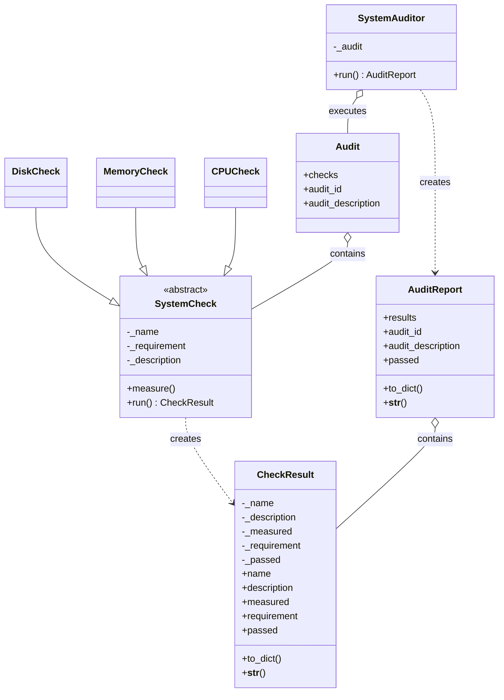

# Project: System Auditor (Part 1)

## Goal

IT administrators need a quick way to check whether a computer meets minimum
requirements. In this project, you will build a command-line program that reads
checks from a JSON file, measures the computer, and prints an overall PASS or
FAIL report. The program can also save the report as JSON.

You are given the class diagram, a checks file, the `CPUCheck` implementation,
and most of the tests. Implement the rest of the program so the supplied tests
pass, and write the missing test for `CPUCheck`.

## Prior Work

This project uses techniques from work you have already completed:

| Concepts                                     | Prior work                                                                                                                                                                                                        |
| -------------------------------------------- | ----------------------------------------------------------------------------------------------------------------------------------------------------------------------------------------------------------------- |
| `psutil`, `uv`, and multiple modules         | [system_report](../../subjects/uv_dependencies_virtual_environments/exercises/system_report/system_report_lab.md), [sysinfo_reporter](../../subjects/python_review/exercise/sysinfo_reporter/sysinfo_reporter.md) |
| `sys.argv` and command-line usage            | [command-line word count](../../subjects/cmdline_arguments/exercises/letter_frequency_cmd/cmd_line_arguments_letter_frequency.md)                                                                                 |
| Reading and writing JSON files               | [task flattener](../../subjects/recursion/labs/task_flattener/student/recusrion_task_flattener_lab.md)                                                                                                            |
| Classes and objects containing other objects | [Books and Library](../../subjects/object_oriented/exercises/books_library/student/intro_oo_library.md), [Blackjack](../../subjects/object_oriented/exercises/blackjack/student/README.md)                        |
| Inheritance and polymorphism                 | [Shapes and Inheritance](../../subjects/object_oriented/exercises/shapes_inheritance/student/README.md)                                                                                                           |
| Pytest fixtures and `monkeypatch`            | [pytest Monkey Patch](../../subjects/testing_pytest/exercises/monkey_patch/monkey_patch.md)                                                                                                                       |

## Setup

The project will be set up with `uv`.

Copy the supplied files from [student_p01](student_p01/) into your project
folder.

After setup, `pyproject.toml` and `uv.lock` should be created. The other files
are supplied or created as follows:

| File                         | Who provides or writes it                            | Purpose                                                                   |
| ---------------------------- | ---------------------------------------------------- | ------------------------------------------------------------------------- |
| `.gitignore`                 | uv setup creates                                     | Determines what is excluded from version control                          |
| `pyproject.toml`             | uv setup creates                                     | Project settings and dependencies.                                        |
| `uv.lock`                    | uv setup creates                                     | Records the exact dependency versions.                                    |
| `.vscode/launch.json`        | Supplied                                             | Starts the debugger with your input and optional output filenames.        |
| `conftest.py`                | Supplied                                             | Provides fixtures that fake system measurements for tests.                |
| `test_checks.py`             | Supplied; you add a test for `CPUCheck`              | Tests the check classes.                                                  |
| `test_auditor.py`            | Supplied                                             | Tests that the auditor runs checks and reports their results.             |
| `test_system_auditor_cli.py` | Supplied                                             | Tests command-line behavior and JSON output.                              |
| `audit_host_baseline.json`   | Supplied                                             | Defines the host-baseline audit and its checks.                           |
| `checks.py`                  | Supplied with `CPUCheck`; you add the remaining code | Defines the check classes and creates checks from policy entries.         |
| `audit.py`                   | You create                                           | Groups the checks with the audit ID and description.                      |
| `system_auditor.py`          | You create                                           | Runs the checks and collects their results.                               |
| `audit_report.py`            | You create                                           | Stores results and presents the overall audit outcome.                    |
| `system_auditor_cli.py`      | You create                                           | Reads command-line input, runs the audit, and prints or saves the report. |

## Program Requirements

### Supplied Audit Definition

The supplied
[audit_host_baseline.json](student_p01/audit_host_baseline.json) contains one
audit definition. Its `audit_id` identifies the definition,
`audit_description` describes it, and `checks` lists the checks to run. Each
check has a `type`, a `requirement`, and a `description`:

```json
{
  "audit_id": "host-baseline",
  "audit_description": "Check minimum disk space, memory, and CPU requirements.",
  "checks": [
    {
      "type": "disk",
      "requirement": 20,
      "description": "Ensure at least 20 GiB of free space on the system drive."
    },
    {
      "type": "memory",
      "requirement": 8,
      "description": "Ensure at least 8 GiB of installed memory."
    },
    {
      "type": "cpu",
      "requirement": 4,
      "description": "Ensure at least 4 logical CPUs are available."
    }
  ]
}
```

The audit ID and description must be non-empty strings. The `checks` value must
be a list. A bare list of checks is no longer an audit definition.

| Type     | Measurement                                               | Requirement           |
| -------- | --------------------------------------------------------- | --------------------- |
| `disk`   | Free space on the root drive, converted from bytes to GiB | Minimum free GiB      |
| `memory` | Installed memory, converted from bytes to GiB             | Minimum installed GiB |
| `cpu`    | Number of logical CPUs                                    | Minimum logical CPUs  |

### Notes

- On Windows, `psutil.disk_usage("/")` measures the root of the current drive,
  which may not be the Windows system drive, the root of the current drive is acceptable for this project.

### Command Line

```powershell
uv run system_auditor_cli.py audit_host_baseline.json # output to console
uv run system_auditor_cli.py audit_host_baseline.json report.json # output to console and file
```

`system_auditor_cli` reads arguments from `sys.argv`. The first argument names the audit
definition file. The optional second argument names the JSON report file. If
the argument count is wrong, print a usage message that includes  
`system_auditor_cli.py` and return without running any checks. Always print the
report; write the JSON report only when the optional output argument is
supplied.

### Outputs

#### Console

The console report includes the heading `System Auditor`, a result for each
check, and an overall PASS or FAIL. Each result includes its name, description,
measurement, requirement, and outcome. The tests look for key text, not exact
spacing or number formatting.

For example:

```text
System Auditor
------------------------

Disk Space
Description: Ensure at least 20 GiB of free space on the system drive.
Measured:    40.0
Requirement: 20
Result:      PASS

OVERALL: PASS
Host meets specification.
```

#### JSON

The JSON report has the same `audit_id` and `audit_description` as the checks
file, a `checks` list, and an overall `passed` value. The ID identifies the
audit definition, so it stays the same when the audit is run again. Each item in
`checks` contains `name`, `description`, `measured`, `requirement`, and
`passed`. Results stay in the same order as the checks file. See the supplied
`test_system_auditor_cli.py` for the expected structure and values.

For example, showing one check:

```json
{
  "audit_id": "host-baseline",
  "audit_description": "Check minimum disk space, memory, and CPU requirements.",
  "checks": [
    {
      "name": "Disk Space",
      "description": "Ensure at least 20 GiB of free space on the system drive.",
      "measured": 40.0,
      "requirement": 20,
      "passed": true
    }
  ],
  "passed": true
}
```

## Design

Use this class diagram as your guide. It shows the required classes and how they
relate. Keep the class and method names shown because the tests use them.



## Using the Supplied Tests

The tests do not inspect the real computer. The `fake_system` fixture in
`conftest.py` replaces `psutil` calls with fixed values: 40 GiB of free disk
space, 16 GiB of memory, and 8 CPUs. The `checks_file` fixture creates a
temporary JSON policy for the command-line tests; it does not read or modify the
supplied `audit_host_baseline.json`.

To use a fixture, include its name as a test function parameter. For example,
the disk and memory tests request `fake_system`. The command-line tests also use
`monkeypatch` to replace `sys.argv`. Pytest restores patched values after each
test.

The supplied check tests are named `test_disk_check` and `test_memory_check`.
Use them as models for the CPU test. Do not change the supplied tests to make
them pass; change your code instead.

## Build Steps

### Step 1: Complete `checks.py`

This module contains `create_check()`, and the check and result classes.

- `SystemCheck` is abstract. It stores the name, requirement, and description in
  protected attributes and requires subclasses to implement `measure()`. Its
  `run()` measures once, compares the result with the requirement, and returns a
  `CheckResult` without printing. A check passes when its measurement is equal
  to or greater than its requirement. Keep each policy description with its
  check so it appears in the report.

- `DiskCheck`, `MemoryCheck`, and `CPUCheck` inherit from `SystemCheck`. The
  supplied `CPUCheck` shows how a subclass sets its display name and implements
  `measure()`. The display names are `Disk Space`, `Memory`, and `CPUs`.

- `CheckResult` stores protected attributes and exposes read-only properties for
  `name`, `description`, `measured`, `requirement`, and `passed`. Its
  `to_dict()` returns the result fields; its `__str__()` formats the result.

- `create_check(specification)` turns one entry from the checks file into an
  object for one system check. The entry tells it what to check, the minimum
  value required, and the description to include in the report. For example, a
  disk entry with a requirement of `20` creates a disk check that requires at
  least 20 GiB of free space. Creating the check does not measure the computer;
  the auditor runs it later. If the entry names an unknown check type, raise a
  `ValueError` that includes that type. If a required entry is missing, the
  check cannot be created.

In tests, it is acceptable to read a protected attribute when that makes a test
clearer or more precise. In other code, use the public interface.

The `CPUCheck` implementation is supplied, but its test is not. Add a test named
`test_cpu_check` to `test_checks.py`. It should:

1. Request the `fake_system` fixture so the test uses the fake `psutil`
   functions.
1. Use `create_check()` with a policy entry whose type is `cpu`.
1. Check that the factory returns a `CPUCheck` and keeps the policy's
   requirement and description.
1. Call `measure()` and check that it returns `8`.

To make sure the test can catch a bug, temporarily make `CPUCheck.measure()`
return a wrong value. Run the test and confirm it fails, then restore the
correct implementation. Run `test_checks.py` when the check classes and CPU test
are complete.

### Step 2: Create `audit.py`

`Audit(checks, audit_id, audit_description)` groups the audit definition. Store
the supplied values as public attributes named `checks`, `audit_id`, and
`audit_description`. The list contains check objects, not JSON dictionaries.
This class does not measure the computer, read files, or print.

### Step 3: Create `system_auditor.py` and `audit_report.py`

#### `system_auditor.py`

`SystemAuditor(audit)` stores an `Audit` object. Its `run()` runs `audit.checks`
in order and returns an `AuditReport` with the audit's ID and description. It
continues after check failures (not exceptions) and does not check concrete
types. Running the same audit again takes fresh measurements.

#### `audit_report.py`

`AuditReport(results, audit_id, audit_description)` stores the results and audit
identity, reports whether all checks passed, and provides `to_dict()` and
`__str__()` methods for JSON and console output.

An `Audit` describes what to check; an `AuditReport` records what happened when
those checks ran.

After implementing both classes, run `test_auditor.py` to check audit execution
and reporting.

### Step 4: Create `system_auditor_cli.py`

`main()` checks the arguments, reads the audit definition, creates and runs the
checks, prints the report, and writes the optional JSON file. Create an `Audit`
from the check objects, ID, and description, then pass it to `SystemAuditor`.
Raise `KeyError` for a missing required field and `ValueError` for an invalid
audit object, ID, description, or checks list. Keep file access and printing in
`system_auditor_cli.py`, not in the check or report classes.

## Final Verification

After completing `system_auditor_cli.py`, run `test_system_auditor_cli.py`.
Then run the complete test suite:

```powershell
uv run pytest
```

Run the program from the project directory:

```powershell
uv run system_auditor_cli.py audit_host_baseline.json
uv run system_auditor_cli.py audit_host_baseline.json report.json
uv run system_auditor_cli.py
```

Confirm that the first command prints a report, the second also creates a valid
JSON report, and the third prints a usage message. To try the FAIL case, make a
copy of `audit_host_baseline.json` and set one requirement higher than your
computer's measured value.

### Debugging in VS Code

Ensure the supplied `.vscode` folder is in your project folder. Open your
project folder in VS Code, with the Python and Python Debugger extensions
installed. Select your project's `.venv` interpreter.

After you have implemented `system_auditor_cli.py`, confirm that the supplied
`audit_host_baseline.json` is in your project folder. Set a breakpoint and open
Run and Debug. Choose a launch option and press F5:

- `System Auditor: Console report` is the first option. It asks for the input
  filename, defaulting to `audit_host_baseline.json`. It does not write a JSON
  report file.
- `System Auditor: Save JSON report` also asks for an output filename,
  defaulting to `report.json`. It still prints the console report.

Filenames are relative to your project folder unless you enter a full path.

## Git Tracking and Submission

1. Create a git repository for your machine and use the `uv` generated git ignore.
1. Add a commit for every build step above.
1. create an annotated Tag named `project_p01` with the description: `Completed ACIT2515 Project Part 01`
1. Create a zip file of all of the listed project files and your `.git` directory and upload the zip file to the project drop box in the learning hub.

