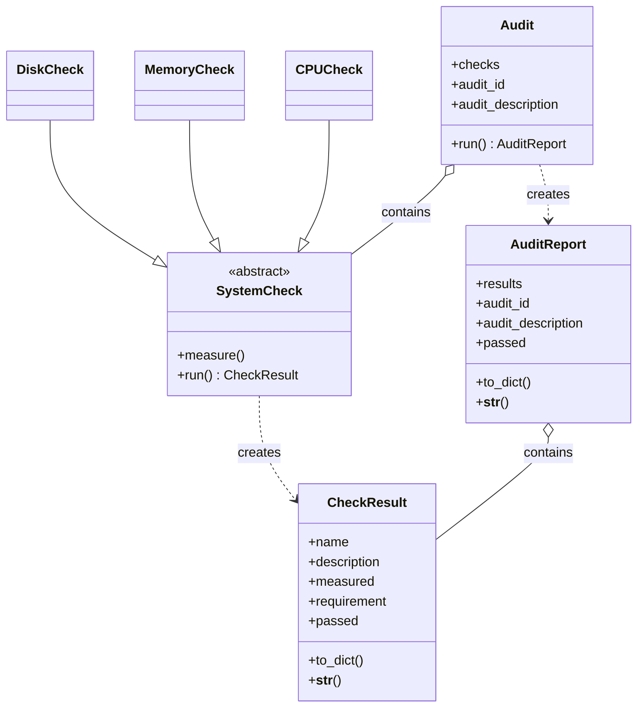

# Project: System Auditor (Part 1)

## Goal

IT administrators need a quick way to check whether a computer meets minimum
requirements. In this project, you will build a command-line program that reads
checks from a JSON file, measures the computer, and prints an overall PASS or
FAIL report. The program can also save the report as JSON.

You are given the class diagram, a checks file, the `CPUCheck` implementation,
and most of the tests. Implement the rest of the program so the supplied tests
pass, and write the missing test for `CPUCheck`.

## Prior Work

This project uses techniques from work you have already completed:

| Concepts                                     | Prior work                                                                                                                                                                                                        |
| -------------------------------------------- | ----------------------------------------------------------------------------------------------------------------------------------------------------------------------------------------------------------------- |
| `psutil`, `uv`, and multiple modules         | [system_report](../../uv_dependencies_virtual_environments/exercises/system_report/system_report_lab.md), [sysinfo_reporter](../../labs/wk01/sysinfo_reporter.md) |
| `sys.argv` and command-line usage            | [command-line word count](../../cmdline_arguments/exercises/letter_frequency_cmd/cmd_line_arguments_letter_frequency.md)                                                 |
| Reading and writing JSON files               | [task flattener](../../recursion/labs/task_flattener/student/recusrion_task_flattener_lab.md)                                                                            |
| Classes and objects containing other objects | [Books and Library](../../object_oriented/exercises/books_library/student/intro_oo_library.md), [Blackjack](../../object_oriented/exercises/blackjack/student/README.md) |
| Inheritance and polymorphism                 | [Shapes and Inheritance](../../object_oriented/exercises/shapes_inheritance/student/README.md)                                                                           |
| Pytest fixtures and `monkeypatch`            | [pytest Monkey Patch](../../testing_pytest/exercises/monkey_patch/monkey_patch.md)                                                                                       |
| Git commits and tags                         | [Git: Just Enough](../../git/notes/git_just_enough.md)                                                                                                                                                                    |

## Setup

The project will be set up with `uv`.

Once the starter package has been updated, copy the supplied files from
[student_p01](student_p01/) into your project folder.

After setup, `pyproject.toml` and `uv.lock` should be created. The updated
package is intended to provide the files marked "Supplied" below.

| File                         | Who provides or writes it                            | Purpose                                                                   |
| ---------------------------- | ---------------------------------------------------- | ------------------------------------------------------------------------- |
| `.gitignore`                 | Supplied                                             | Determines what is excluded from version control.                         |
| `pyproject.toml`             | uv setup creates                                     | Project settings and dependencies.                                        |
| `uv.lock`                    | uv setup creates                                     | Records the exact dependency versions.                                    |
| `.vscode/launch.json`        | Supplied                                             | Starts the debugger with input and optional output filenames.             |
| `conftest.py`                | Supplied                                             | Provides fixtures that fake system measurements for tests.                |
| `test_check_result.py`       | Supplied                                             | Tests the presentation of individual check results.                       |
| `test_checks.py`             | Supplied; you add a test for `CPUCheck`              | Tests the check classes.                                                  |
| `test_audit_report.py`       | Supplied                                             | Tests the overall report and its presentation.                           |
| `test_audit.py`              | Supplied                                             | Tests audit construction and execution.                                   |
| `test_system_auditor_cli.py` | Supplied                                             | Tests command-line behavior and JSON output.                              |
| `audit_host_baseline.json`   | Supplied                                             | Defines the host-baseline audit and its checks.                           |
| `check_result.py`            | You create                                           | Stores and presents the result of one check.                              |
| `checks.py`                  | Supplied with `CPUCheck`; you add the remaining code | Defines the check classes and creates checks from policy entries.         |
| `audit_report.py`            | You create                                           | Stores results and presents the overall audit outcome.                    |
| `audit.py`                   | You create                                           | Builds and runs the checks from an audit definition.                      |
| `system_auditor_cli.py`      | You create                                           | Reads command-line input, runs the audit, and prints or saves the report. |

## Program Requirements

### Supplied Audit Definition

The supplied [audit_host_baseline.json](student_p01/audit_host_baseline.json)
contains one audit definition. Its `audit_id` identifies the definition,
`audit_description` describes it, and `checks` lists the checks to run. Each
check has a `type`, a `requirement`, and a `description`:

```json
{
  "audit_id": "host-baseline",
  "audit_description": "Check minimum disk space, memory, and CPU requirements.",
  "checks": [
    {
      "type": "disk",
      "requirement": 20,
      "description": "Ensure at least 20 GiB of free space on the system drive."
    },
    {
      "type": "memory",
      "requirement": 8,
      "description": "Ensure at least 8 GiB of installed memory."
    },
    {
      "type": "cpu",
      "requirement": 4,
      "description": "Ensure at least 4 logical CPUs are available."
    }
  ]
}
```

The audit ID and description must be non-empty strings, not just whitespace.
The `checks` value must be a list, which may be empty. A bare list of checks is
not an audit definition.

| Type     | Measurement                                               | Requirement           |
| -------- | --------------------------------------------------------- | --------------------- |
| `disk`   | Free space on the root drive, converted from bytes to GiB | Minimum free GiB      |
| `memory` | Installed memory, converted from bytes to GiB             | Minimum installed GiB |
| `cpu`    | Number of logical CPUs                                    | Minimum logical CPUs  |

### Notes

- On Windows, `psutil.disk_usage("/")` measures the root of the current drive,
  which may not be the Windows system drive, the root of the current drive is
  acceptable for this project.
- Disk and memory measurements are converted from bytes to GiB using
  `1024 ** 3` bytes per GiB.

### Command Line

```powershell
uv run system_auditor_cli.py audit_host_baseline.json # output to console
uv run system_auditor_cli.py audit_host_baseline.json report.json # output to console and file
```

`system_auditor_cli` reads arguments from `sys.argv`. The first argument names
the audit definition file. The optional second argument names the JSON report
file. If the argument count is wrong, print a usage message that includes
`Usage:` and `system_auditor_cli.py`, then return without running any checks.
Always print the report; write the JSON report only when the optional output
argument is supplied.

### Outputs

#### Console

The console report includes the heading `System Auditor`, a result for each
check, and an overall PASS or FAIL. Each result includes its name, description,
measurement, requirement, and outcome. The tests look for key text, not exact
spacing or number formatting.

For example:

```text
System Auditor
------------------------

Disk Space
Description: Ensure at least 20 GiB of free space on the system drive.
Measured:    40.0
Requirement: 20
Result:      PASS

OVERALL: PASS
Host meets specification.
```

#### JSON

The JSON report has the same `audit_id` and `audit_description` as the checks
file, a `checks` list, and an overall `passed` value. The ID identifies the
audit definition, so it stays the same when the audit is run again. Each item in
`checks` contains `name`, `description`, `measured`, `requirement`, and
`passed`. Results stay in the same order as the checks file. See the supplied
`test_system_auditor_cli.py` for the expected structure and values.

For example, showing one check:

```json
{
  "audit_id": "host-baseline",
  "audit_description": "Check minimum disk space, memory, and CPU requirements.",
  "checks": [
    {
      "name": "Disk Space",
      "description": "Ensure at least 20 GiB of free space on the system drive.",
      "measured": 40.0,
      "requirement": 20,
      "passed": true
    }
  ],
  "passed": true
}
```

## Design

Use this class diagram as your guide. It shows the required classes and how they
relate. Keep the public class and method names shown because the tests use
them. You may choose your own internal attribute names.



## Using the Supplied Tests

The tests will not inspect the real computer. The `fake_system` fixture
in `conftest.py` replaces `psutil` calls with fixed values: 40 GiB of free disk
space, 16 GiB of memory, and 8 CPUs. The `checks_file` fixture in
`test_system_auditor_cli.py` creates a temporary JSON policy for the
command-line tests; it does not read or modify the supplied
`audit_host_baseline.json`.

To use a fixture, include its name as a test function parameter. For example,
the disk and memory tests request `fake_system`. The command-line tests also
use `monkeypatch` to replace `sys.argv`. The audit and report unit tests use
fake objects to test those classes separately from their collaborators. Pytest
restores patched values after each test.

Use the disk and memory factory tests as models for your CPU test. Do not
change the supplied tests to make them pass; change your code instead.

## Build Steps

### Step 1: Create `check_result.py`

Define `CheckResult(name, description, measured, requirement, passed)` to store
one check's outcome. Expose `name`, `description`, `measured`, `requirement`,
and `passed` as public attributes or properties.

Implement `to_dict()` to return these five fields and `__str__()` to format
the result for the console, including its values and a PASS or FAIL outcome.
Use the labels `Description:`, `Measured:`, `Requirement:`, and `Result:`
so the values can be identified.

The shared test setup imports `checks.py`, so complete Step 2 before running
the tests for this class.

### Step 2: Complete `checks.py`

This module contains the check classes and `create_check()`:

- `SystemCheck` is an abstract class. It keeps the requirement and description
  for a check and requires subclasses to implement `measure()`. Its `run()`
  measures once, compares the result with the requirement, and returns a
  `CheckResult` without printing. A check passes when its measurement is equal
  to or greater than its requirement.
- `DiskCheck`, `MemoryCheck`, and `CPUCheck` inherit from `SystemCheck` and
  measure their respective resources. Their display names are `Disk Space`,
  `Memory`, and `CPUs`. Each can be constructed with a requirement and a
  description, for example `CPUCheck(4, "At least 4 logical CPUs.")`. The
  supplied `CPUCheck` is a starting point; adapt it as needed to work with
  your `SystemCheck`.
- `create_check(specification)` turns one parsed JSON check dictionary into
  the matching check object. Each specification has a `type`, a `requirement`,
  and a `description`. Creating a check must not measure the computer.

Reject a specification with a missing required key or an unknown check type
by raising an exception. For example, `KeyError` can indicate a missing key
and `ValueError` can identify an unknown type. You do not need to use those
exact exception types. One way to select the class is a `check_types`
dictionary inside `create_check()` that maps type names to check classes.

The `CPUCheck` implementation is supplied, but its factory test is not. Add a
test named `test_cpu_check` to `test_checks.py`. It should:

1. Request the `fake_system` fixture so the test uses fake `psutil` functions.
1. Use `create_check()` with a policy entry whose type is `cpu`.
1. Check that the factory returns a `CPUCheck`. Call `run()` and check that its
   result contains the policy's requirement and description.
1. Call `measure()` and check that it returns `8`.

To make sure the test can catch a bug, temporarily make `CPUCheck.measure()`
return a wrong value. Run the test and confirm it fails, then restore the
correct implementation. Run `test_checks.py` when the check classes and CPU
test are complete. Then run the checks and result tests together:

```powershell
uv run pytest test_checks.py test_check_result.py
```

### Step 3: Create `audit_report.py`

Define `AuditReport(results, audit_id, audit_description)` to store the check
results and audit identity. Its `passed` attribute or property is true when
every check passed, and false when any check failed. An empty results list
passes because no checks failed.

Implement `to_dict()` with the JSON report fields described above and
`__str__()` with the console report. Keep results in their original order.
Run `uv run pytest test_audit_report.py` when the class is complete.

### Step 4: Create `audit.py`

`Audit(definition)` accepts a dictionary parsed from the audit definition
JSON. Validate that the required keys are present, that the ID and description
are non-empty strings, and that `checks` is a list. Reject invalid definitions
by raising an exception; a particular exception type is not required.

Use `create_check()` to build the check objects and store them as `checks`.
Also expose `audit_id` and `audit_description`. Constructing an audit does not
measure the computer, read files, or print.

Implement `run()` to run every check in order and return an `AuditReport` with
the results, ID, and description. A failed check must not stop later checks;
measurement errors should not be hidden. Do not check each object's concrete
type before calling its `run()` method. Running the same audit again takes
fresh measurements and returns a new report.

An `Audit` describes what to check; an `AuditReport` records what happened when
those checks ran. Run `uv run pytest test_audit.py` when `Audit` is complete.

### Step 5: Create `system_auditor_cli.py`

`main()` checks the arguments, reads the audit definition, creates an
`Audit(definition)`, and calls its `run()` method. Print the resulting report
and write its dictionary as JSON when an output filename is supplied. Keep file
access and printing in `system_auditor_cli.py`, not in the audit, check, or
report classes. Do not hide invalid-definition, file, or measurement errors.

## Final Verification

After completing `system_auditor_cli.py`, run
`uv run pytest test_system_auditor_cli.py`. Then run the complete test suite:

```powershell
uv run pytest
```

Run the program from the project directory:

```powershell
uv run system_auditor_cli.py audit_host_baseline.json
uv run system_auditor_cli.py audit_host_baseline.json report.json
uv run system_auditor_cli.py
```

Confirm that the first command prints a report, the second also creates a valid
JSON report, and the third prints a usage message. To try the FAIL case, make a
copy of `audit_host_baseline.json` and set one requirement higher than your
computer's measured value.

### Debugging in VS Code

Ensure the supplied `.vscode` folder is in your project folder. Open your
project folder in VS Code, with the Python and Python Debugger extensions
installed. Select your project's `.venv` interpreter.

After you have implemented `system_auditor_cli.py`, confirm that the supplied
`audit_host_baseline.json` is in your project folder. Set a breakpoint and open
Run and Debug. Choose a launch option and press F5:

- `System Auditor: Console report` is the first option. It asks for the input
  filename, defaulting to `audit_host_baseline.json`. It does not write a JSON
  report file.
- `System Auditor: Save JSON report` also asks for an output filename,
  defaulting to `report.json`. It still prints the console report.

Filenames are relative to your project folder unless you enter a full path.

## Git Tracking for Submission

1. Create a git repository for your machine and use the `uv` generated git
   ignore.
1. Add a commit for every build step above.
1. create an annotated Tag named `project_p01` with the description:
   `Completed ACIT2515 Project Part 01`
