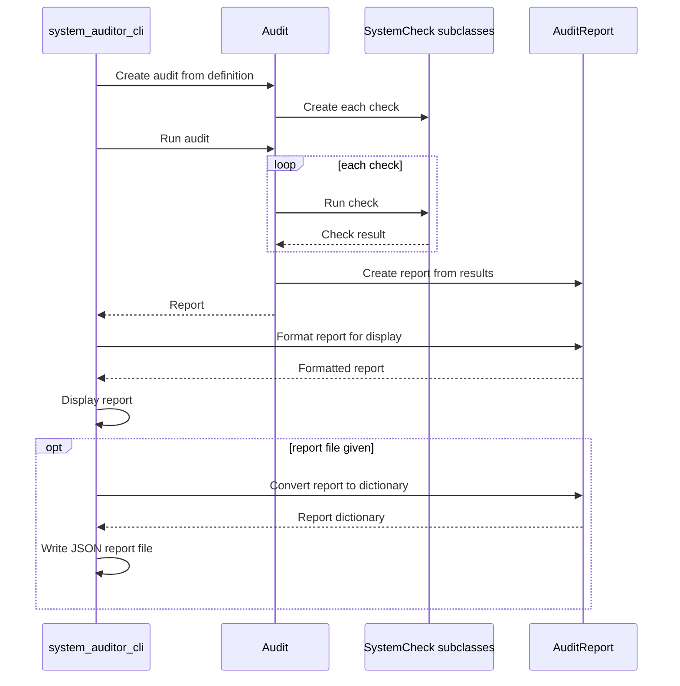
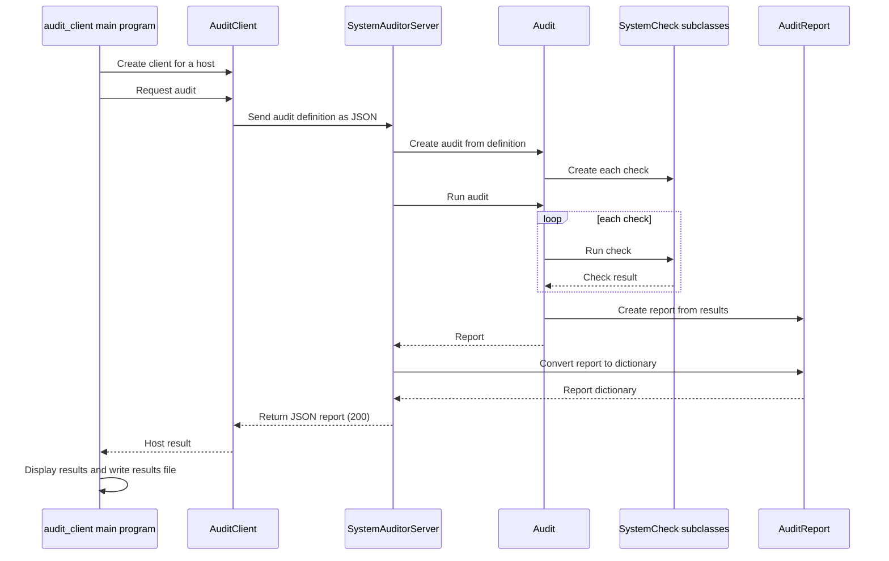
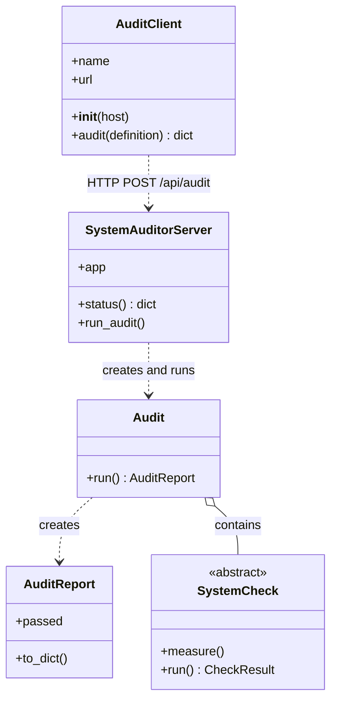

# Project: System Auditor (Part 2)

## Goals

In Part 1, the System Auditor checked one computer from the command line. In
Part 2, add a Flask API and an HTTPX client so one definition can be audited on
several hosts. Continue in the same project folder and Git repository. Keep the
Part 1 audit classes unchanged; only the input and output change.

### Design

#### Part 1: Command-line version

The command-line program reads a definition and writes the report:



#### Part 2: HTTP version

The client sends a definition to a Flask server, which uses the same audit
objects:



The server handles HTTP and the Part 1 classes do the audit. The client only
displays the server's results; it never compares measurements with requirements.

#### Classes

`SystemAuditorServer` and `AuditClient` are new. The other classes come from
Part 1 unchanged.



### Operation

#### Server

From the project folder, start the server with either command. It listens on
`http://127.0.0.1:5000` until you press `Ctrl+C`:

```powershell
uv run system_auditor_server.py
uv run flask --app system_auditor_server run --debug
```

#### Client

The client sends one audit request to each host in `hosts.json`. It does not
store results on the server, so you can run it again with another definition.
See the client requirements for command examples.

#### Debugging

To use the VS Code debugger, add these two entries to the `configurations` list
in `.vscode/launch.json`:

```json
{
  "name": "System Auditor: Server",
  "type": "debugpy",
  "request": "launch",
  "module": "flask",
  "cwd": "${workspaceFolder}",
  "args": ["--app", "system_auditor_server", "run", "--debug", "--no-debugger", "--no-reload"],
  "console": "integratedTerminal"
},
{
  "name": "System Auditor: Client",
  "type": "debugpy",
  "request": "launch",
  "program": "${workspaceFolder}/audit_client.py",
  "cwd": "${workspaceFolder}",
  "console": "integratedTerminal",
  "args": ["audit_host_baseline.json", "hosts.json", "results.json"]
}
```

To debug the server, launch `System Auditor: Server`, set a breakpoint in
`run_audit`, and run the client from a terminal. To debug the client, start the
server from a terminal and launch `System Auditor: Client`.

### Prior Work / Resources

| Concepts                                        | Prior work                                                                            |
| ----------------------------------------------- | ------------------------------------------------------------------------------------- |
| The audit, check, and report classes            | [System Auditor Part 1](system_auditor_p01_student.md)                                |
| HTTP methods, status codes, and JSON            | [HTTP Review](../../web_http/notes/http_review.md)                           |
| Flask applications, routes, and JSON responses  | [Introduction to Flask](../../flask_orm/notes/flask_simple_intro.md)         |
| Testing Flask applications and HTTP clients     | [Testing Flask with pytest](../../flask_orm/notes/flask_testing_w_pytest.md) |
| HTTPX requests, timeouts, and error handling    | [HTTPX Clients](../../web_http/notes/httpx_python_http_clients.md)           |
| A Flask API server with a matching HTTPX client | [music_library_server](../../flask_orm/demo/music_library_server/)           |
| Git commits and tags                            | [Git: Just Enough](../../git/notes/git_just_enough.md)                       |

Use the [music library server](../../flask_orm/demo/music_library_server/)
as a model for the Flask app, HTTP client, test fixtures, and project layout.

## Requirements

### Project Layout and Tool Setup

- Continue in the Part 1 folder and repository; do not make a copy.
- Add Flask and HTTPX with `uv add flask httpx`.
- Move `conftest.py` and all Part 1 `test_*.py` files, unchanged, into a
  `tests` folder.
- Add these pytest settings to `pyproject.toml`. Update an existing pytest
  section rather than adding a duplicate:

  ```toml
  [tool.pytest.ini_options]
  testpaths = ["tests"]
  pythonpath = ["."]
  ```

- Before copying the new skeletons, run the Part 1 tests from the project
  folder:

  ```powershell
  uv run python -m pytest
  ```

- Then copy the supplied [server test skeleton](student_p02/test_system_auditor_server.py)
  and [client test skeleton](student_p02/test_audit_client.py) into `tests`.

#### Final Project File Layout

When you finish, the project will contain these files. Paths are relative to the
project folder.

| File                                  | Description                                                             | Origin / change   |
| ------------------------------------- | ----------------------------------------------------------------------- | ----------------- |
| `.gitignore`                          | Excludes generated and local files from version control.                | Part 1: unchanged |
| `README.md`                           | Project description referenced by `pyproject.toml`.                     | Part 1: unchanged |
| `pyproject.toml`                      | Project settings, dependencies, and pytest configuration.               | Part 1: modified  |
| `uv.lock`                             | Exact dependency versions, including Flask and HTTPX.                   | Part 1: modified  |
| `.vscode/launch.json`                 | Debugger configurations for the Part 1 CLI and Part 2 server and client. | Part 1: modified  |
| `audit_host_baseline.json`            | Baseline audit definition with disk, memory, and CPU requirements.      | Part 1: unchanged |
| `check_result.py`                     | Stores and presents the result of one check.                            | Part 1: unchanged |
| `checks.py`                           | Defines the check classes and creates checks from audit definitions.    | Part 1: unchanged |
| `audit_report.py`                     | Stores check results and presents the overall audit outcome.            | Part 1: unchanged |
| `audit.py`                            | Builds and runs the checks from an audit definition.                    | Part 1: unchanged |
| `system_auditor_cli.py`               | Runs an audit locally and displays or saves its report.                 | Part 1: unchanged |
| `tests/conftest.py`                   | Shared fixtures that fake system measurements.                          | Part 1: moved     |
| `tests/test_check_result.py`          | Tests individual check results and their presentation.                  | Part 1: moved     |
| `tests/test_checks.py`                | Tests the check classes.                                                | Part 1: moved     |
| `tests/test_audit_report.py`          | Tests audit reports and their presentation.                             | Part 1: moved     |
| `tests/test_audit.py`                 | Tests audit construction and execution.                                 | Part 1: moved     |
| `tests/test_system_auditor_cli.py`    | Tests the local command-line program and JSON output.                   | Part 1: moved     |
| `system_auditor_server.py`            | Flask API that runs audits and returns JSON reports.                    | Part 2: created   |
| `audit_client.py`                     | `AuditClient` and the command-line program for auditing multiple hosts. | Part 2: created   |
| `hosts.json`                          | Names and URLs of the hosts to audit.                                   | Part 2: created   |
| `tests/test_system_auditor_server.py` | Server tests and fixtures, completed from the supplied skeleton.        | Part 2: created   |
| `tests/test_audit_client.py`          | Client tests, completed from the supplied skeleton.                     | Part 2: created   |
| `results.json`                        | Host results generated by running the client.                           | Part 2: created   |

### Server

In `system_auditor_server.py`, define `SystemAuditorServer`, `create_app()`,
and `main()`. The class creates the Flask app and registers routes with
`add_url_rule`. `create_app()` returns the app; `main()` runs it in debug mode
on `127.0.0.1:5000`.

#### API

Implement these routes:

| Method | Path          | Request body              | Success response           |
| ------ | ------------- | ------------------------- | -------------------------- |
| GET    | `/api/status` | None                      | 200 `{"status": "online"}` |
| POST   | `/api/audit`  | The audit definition JSON | 200 with the audit report  |

`POST /api/audit` accepts the Part 1 definition as JSON. It creates and runs a
new `Audit` for each request and returns `AuditReport.to_dict()`. Because the
audit is sent in the request body and is not stored, use POST and return 200;
the report's `passed` field indicates whether the host met the policy. Read the
body with `request.get_json(silent=True)`.

Return these status codes:

| Situation | Status | Response |
| --- | --- | --- |
| The audit completes, whether it passes or fails | 200 | Audit report |
| The body is missing or is not JSON | 400 | `{"error": "Request body must be JSON"}` |
| `Audit(definition)` raises `KeyError`, `TypeError`, or `ValueError` | 400 | `{"error": "Invalid audit definition: ..."}` |
| A measurement raises an exception during `audit.run()` | 500 | `{"error": "Measurement failed: ..."}` |
| The request uses the wrong method | 405 | Flask response |

Catch measurement errors only around `audit.run()`, not around the whole view.
The server has no login, so run it only on your own computer. It must listen on
`127.0.0.1` and accept only the `disk`, `memory`, and `cpu` check types.

### Client

In `audit_client.py`, define `TIMEOUT_SECONDS = 5.0`, `AuditClient`,
`load_json()`, `format_result()`, and `main()`. Do not import Part 1 classes.

`AuditClient(host)` stores the host's `name` and `url`. Its
`audit(definition)` method sends a POST request to `self.url + "/api/audit"`
with `json=definition` and `timeout=TIMEOUT_SECONDS`. It calls
`raise_for_status()` before reading the response JSON, then returns a new host
result. It does not read files or print.

| Result | Meaning | `checks` | `error` |
| --- | --- | --- | --- |
| `PASS` | Report has `"passed": true` | Report checks | `None` |
| `FAIL` | Report has `"passed": false` | Report checks | `None` |
| `CONNECTION ERROR` | `ConnectError` or `TimeoutException` | `[]` | Exception text |
| `HTTP ERROR` | `HTTPStatusError`, such as a 400 or 500 | `[]` | `HTTP <status code>: <response text>` |

Every result has `name`, `url`, `result`, `checks`, and `error`. Strip
whitespace from HTTP response text. Set an HTTP error to
`f"HTTP {error.response.status_code}: {error.response.text.strip()}"`. The
client copies the server's `passed` value; it does not compare measurements
with requirements.

`main()` reads three arguments from `sys.argv`: the definition file, hosts
file, and output file. It displays each result and writes the audit ID and host
results in hosts-file order using `json.dump(..., indent=4)`. An error for one
host must not stop the remaining audits. If the argument count is wrong, print
a usage message containing `Usage:` and `audit_client.py`, and make no
requests.

#### Command examples

Run the client from the project folder while the server is running. Arguments
are the definition file, hosts file, and output file:

```powershell
uv run audit_client.py audit_host_baseline.json hosts.json results.json
```

Run a different audit and save it to a separate results file:

```powershell
uv run audit_client.py audit_too_strict.json hosts.json results_strict.json
```

With the wrong number of arguments, the client prints a usage message and makes
no requests:

```powershell
uv run audit_client.py
```

```text
Usage: python audit_client.py <audit_definition.json> <hosts.json> <results.json>
```

#### Console output

Print the host name, URL, and result. For checks, format measurements to one
decimal place. For errors, print the error text. For example:

```text
loopback (http://127.0.0.1:5000): PASS
  Disk Space: measured 40.0, required 20 - PASS
  Memory: measured 16.0, required 8 - PASS
  CPUs: measured 8.0, required 4 - PASS
localhost (http://localhost:5000): PASS
  Disk Space: measured 40.0, required 20 - PASS
  Memory: measured 16.0, required 8 - PASS
  CPUs: measured 8.0, required 4 - PASS
offline (http://127.0.0.1:5001): CONNECTION ERROR
  Error: <connection error details>
Results written to results.json
```

#### Results file

The file contains the audit ID and each host's result, including the report
checks or an error:

```json
{
  "audit_id": "host-baseline",
  "hosts": [
    {
      "name": "loopback",
      "url": "http://127.0.0.1:5000",
      "result": "PASS",
      "checks": [
        {
          "name": "Disk Space",
          "description": "Ensure at least 20 GiB of free space on the system drive.",
          "measured": 40.0,
          "requirement": 20,
          "passed": true
        }
      ],
      "error": null
    },
    {
      "name": "offline",
      "url": "http://127.0.0.1:5001",
      "result": "CONNECTION ERROR",
      "checks": [],
      "error": "connection error details"
    }
  ]
}
```

#### `hosts.json`

The hosts file is a JSON list of hosts. Each `url` has a scheme, host, and port,
with no trailing slash. Nothing listens on port 5001, so `offline` shows a
connection error:

```json
[
  { "name": "loopback", "url": "http://127.0.0.1:5000" },
  { "name": "localhost", "url": "http://localhost:5000" },
  { "name": "offline", "url": "http://127.0.0.1:5001" }
]
```

### Testing

Tests do not start a server, send network requests, or measure the real
computer. The Part 1 `fake_system` fixture supplies fixed measurements. Client
tests replace `audit_client.httpx.post` with a fake function.

The skeleton tests intentionally fail until completed. Finish the arrange, act,
and assert steps, then replace each `pytest.fail()` marker. As you work, run
the tests you have completed. See [Pytest notes](../../testing_pytest/notes/pytest.md)
and [Testing Flask with pytest](../../flask_orm/notes/flask_testing_w_pytest.md)
for how to select a test file or individual test. After completing all tests,
run the full suite with the command above.

#### `tests/test_system_auditor_server.py`

##### Fixtures

Write the `app`, `client`, and `definition` fixtures, following the
[music library server tests](../../flask_orm/demo/music_library_server/tests/test_music_library_server.py).
Use `fake_system` in `app`; have `definition` return a fresh definition that
passes the fake measurements.

##### `test_status`

GET `/api/status`; assert status 200 and `{"status": "online"}`.

##### `test_audit_passed`

Post a passing definition; assert status 200 and compare the complete report,
including every field of every check. This test defines the JSON contract.

##### `test_audit_failed_is_200`

Set one requirement above its fake measurement; assert status 200, overall and
individual failure, and all three checks in the response.

##### `test_audit_requires_json`

Post a non-JSON body; assert status 400 and
`{"error": "Request body must be JSON"}`.

##### `test_audit_invalid_definition`

Parametrize the test to remove `audit_id` and `checks` separately. Assert each
request returns status 400 and an error beginning with
`Invalid audit definition`.

##### `test_audit_unknown_check_type`

Post a definition with a `gpu` check; assert status 400 and an
invalid-definition error.

##### `test_audit_measurement_error`

Patch `checks.psutil.disk_usage` with a function that raises
`OSError("disk unavailable")`; assert status 500 and
`{"error": "Measurement failed: disk unavailable"}`.

#### `tests/test_audit_client.py`

Use the supplied `FakeResponse` unchanged. The fake `httpx.post` should return a
configured response or raise an HTTPX error, and must not make a network
request.

##### `test_audit_failed_policy`

Return a 200 report with `passed` false; assert the complete host result is
`FAIL`. Also assert the fake received the expected URL, definition, and 5-second
timeout.

##### `test_audit_passed_policy`

Return a 200 report with `passed` true; assert the result is `PASS`, the
report's checks are preserved, and `error` is `None`.

##### `test_audit_connection_error`

Raise `httpx.ConnectError("Connection refused")`; assert the result is
`CONNECTION ERROR`, `checks` is empty, and `error` is `Connection refused`.

##### `test_audit_http_error`

Return a 500 `FakeResponse`; assert the result is `HTTP ERROR`, `checks` is
empty, and the error starts with `HTTP 500`.

##### `test_main_displays_and_writes_results`

Use `tmp_path` for a definition, a two-host file, and the output file. Patch
`sys.argv` and `httpx.post`; call `main()`. Assert the console shows both host
results and check lines, the output file contains the audit ID and host results
in hosts-file order, and the fake received each URL and the definition.

##### `test_main_usage`

Set `sys.argv` to contain only the program name and patch `httpx.post` with a
fake that fails if called. Call `main()`; assert its output contains `Usage:`
and `audit_client.py`.

## Functionality Additions

Implement one addition at a time and run its tests before moving on. Test
expectations are listed above.

### 1. Status Route

Add `GET /api/status` and the app fixtures. Complete `test_status` in
`tests/test_system_auditor_server.py`.

Start the server and open `http://127.0.0.1:5000/api/status` in a browser.

### 2. Audit Route

Add `POST /api/audit`, handling the success and error responses in the server
requirements. Complete `test_audit_passed`, `test_audit_failed_is_200`,
`test_audit_requires_json`, `test_audit_invalid_definition`,
`test_audit_unknown_check_type`, and `test_audit_measurement_error` in
`tests/test_system_auditor_server.py`.

### 3. Audit Client

Implement `AuditClient` and its result handling. Complete
`test_audit_failed_policy`, `test_audit_passed_policy`,
`test_audit_connection_error`, and `test_audit_http_error` in
`tests/test_audit_client.py`.

### 4. Display and Save Results

Add `load_json()`, `format_result()`, and `main()`. Complete
`test_main_displays_and_writes_results` and `test_main_usage` in
`tests/test_audit_client.py`.

### 5. End-to-End Check

Create `hosts.json` and the VS Code launch configurations, then start the
server and run the client. Run the full test suite with the command above.
Check that:

1. `loopback` and `localhost` show `PASS`, `offline` shows `CONNECTION ERROR`,
   and `results.json` contains three results.
1. Running the client without arguments prints usage.
1. A definition with a requirement above the measured value produces `FAIL`.
1. A definition with a `gpu` check produces `HTTP ERROR` with status 400.
1. With the server stopped, each host produces `CONNECTION ERROR`.

Use separate result files when trying different definitions.

## Submission Directions

1. Commit your work after each functionality addition, in the same repository as
   Part 1. Keep the Part 1 commits and the `project_p01` tag.
1. When everything passes, create an annotated tag named `project_p02` with the
   message `Completed ACIT2515 Project Part 02`. Do not move or replace
   the `project_p01` tag.
1. Zip the project folder, including the `.git` folder, and upload it to the
   project drop box in the learning hub.
