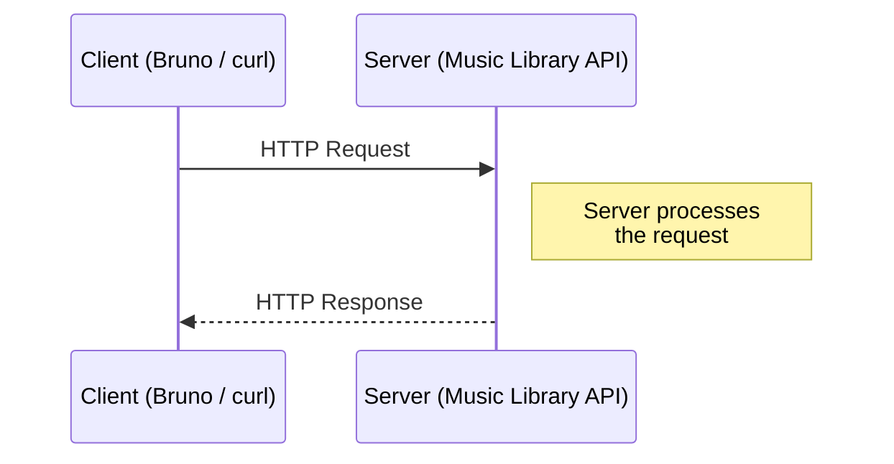
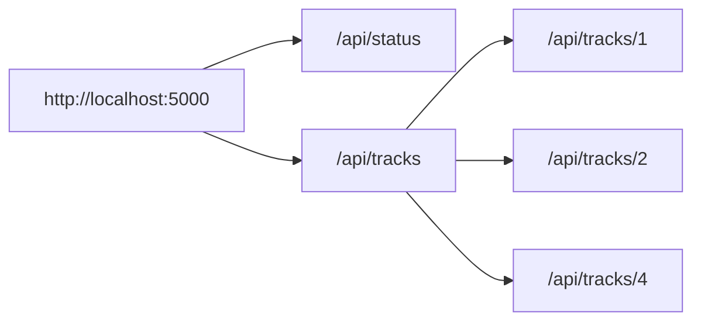
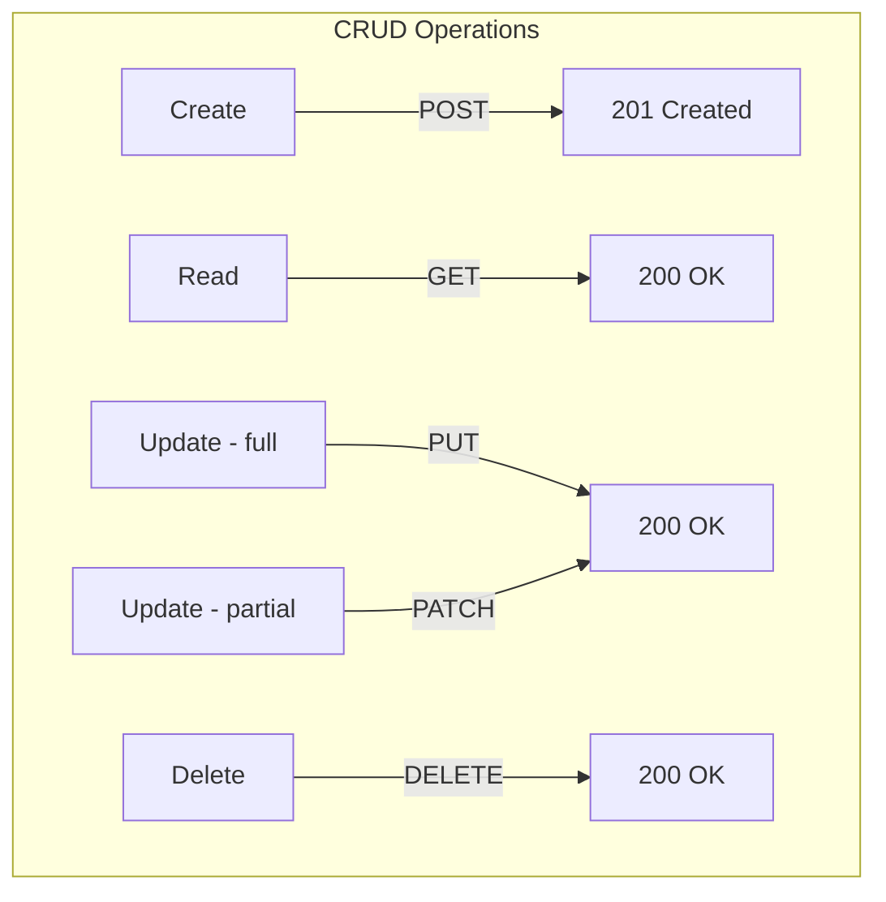
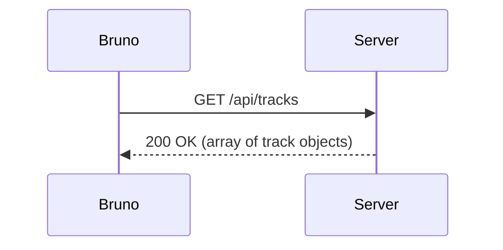
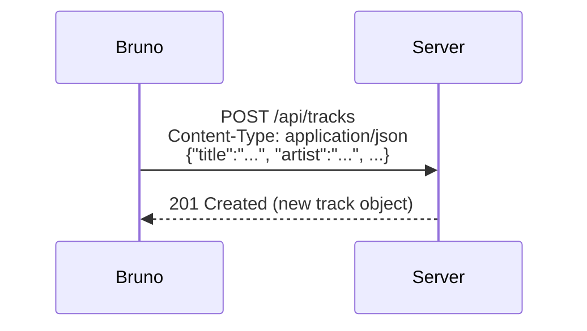
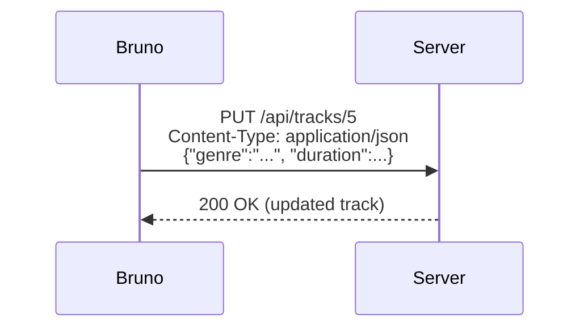
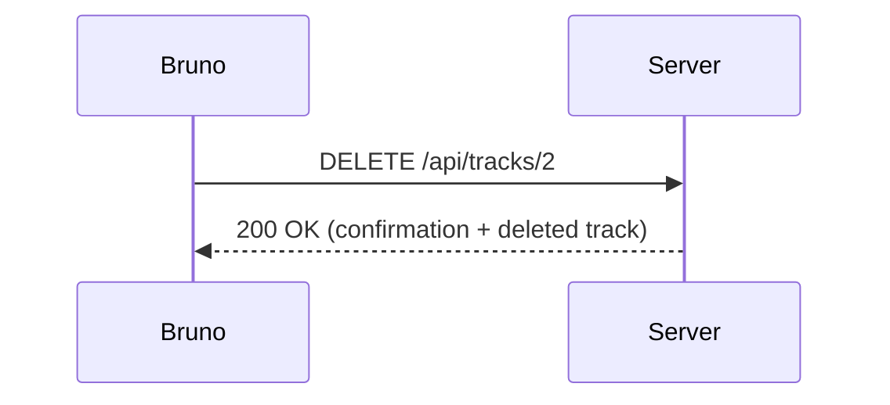
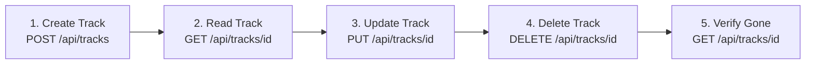

# Exercise: Exploring RESTful APIs with Bruno and cURL

## Overview

|                         |                                                                        |
| ----------------------- | ----------------------------------------------------------------------- |
| **Duration**            | 45 minutes                                                             |
| **Tools**               | VS Code, Bruno VS Code Extension, `curl`, Music Library API (provided) |
| **Prerequisites**       | Python basics, VS Code familiarity, `uv` package manager               |
| **Learning Objectives** | REST APIs, HTTP methods, status codes, request/response cycles         |

In this exercise you use **Bruno** (a VS Code extension) and **`curl`** (a
command-line tool) to talk to a Music Library API. You will send HTTP
requests, read the responses, and do full CRUD (Create, Read, Update, Delete)
operations.

The API is a small Python web server that is provided for you. Later in the
course you will build servers like it with Flask. For now, your job is the
**client** side.

### What is Bruno?

Bruno is an open-source API client that runs inside VS Code. It saves your
requests as plain text files, so they can be version-controlled with Git.

> **Documentation:** <https://docs.usebruno.com/introduction/what-is-bruno>

### What is `curl`?

`curl` is a command-line tool for sending HTTP requests. It comes
pre-installed on Windows, macOS, and Linux. Each Bruno step below includes a
**curl equivalent** so you can try both.

> **Documentation:** <https://curl.se/docs/manpage.html>

## Part 1 — Theory: APIs and REST (15 minutes)

Answer each question in your own words.

### Q1: What is an API?

In one or two sentences: what is an **API** (Application Programming
Interface), and why do applications use them?

### Q2: Client–Server Model

The diagram shows the request–response cycle.



a) Which side **starts** the communication — the client or the server?

### Q3: HTTP Methods

Match each HTTP method to its purpose:

| HTTP Method | Purpose (choose one) |
| ----------- | -------------------- |
| `GET`       | \_\_\_               |
| `POST`      | \_\_\_               |
| `PUT`       | \_\_\_               |
| `PATCH`     | \_\_\_               |
| `DELETE`    | \_\_\_               |

**Options:** Create a new resource · Retrieve a resource · Remove a resource ·
Replace a resource entirely · Partially update a resource

### Q4: HTTP Status Codes

For each code, give its category (Success, Client Error, or Server Error) and
what it means:

| Code                     | Category | Meaning |
| ------------------------ | -------- | ------- |
| `200 OK`                 |          |         |
| `201 Created`            |          |         |
| `400 Bad Request`        |          |         |
| `404 Not Found`          |          |         |
| `405 Method Not Allowed` |          |         |

### Q5: RESTful Resources

A REST API organizes data as **resources**, each with its own URL. The diagram
shows the Music Library API.



a) What does the URL `/api/tracks` represent?

b) What does the URL `/api/tracks/2` represent?

c) To create a new track, which URL and HTTP method would you use?

### Q6: CRUD and REST

CRUD stands for **Create, Read, Update, Delete**. Complete the table:



| CRUD Operation   | HTTP Method | Request Body? | Typical Success Code |
| ---------------- | ----------- | ------------- | -------------------- |
| Create           | \_\_\_      | \_\_\_        | \_\_\_               |
| Read             | \_\_\_      | \_\_\_        | \_\_\_               |
| Update (full)    | \_\_\_      | \_\_\_        | \_\_\_               |
| Update (partial) | \_\_\_      | \_\_\_        | \_\_\_               |
| Delete           | \_\_\_      | \_\_\_        | \_\_\_               |

---

## Part 2 — Setup (5 minutes)

### Step 1: Install the Bruno VS Code Extension

1. Open the Extensions panel in VS Code (`Ctrl+Shift+X`).
1. Search for **"Bruno"** and install the API Client extension.

To verify: open the Command Palette (`Ctrl+Shift+P`) and type `Bruno` — you
should see Bruno commands listed.

### Step 2: Start the Music Library API

If you have not already, download `music_library.zip` from the course site and
unzip it into your course folder. You will reuse this `music_library` folder
in several exercises.

Open a terminal in the `music_library` folder (it contains
`music_library.py`) and run:

```powershell
uv run python music_library.py
```

A startup banner lists the endpoints, and the server runs at
`http://localhost:5000`. **Leave this terminal running.**

Confirm the server is up: open `http://localhost:5000/api/status` in your
browser, or run this in a second terminal:

```powershell
curl -s http://localhost:5000/api/status
```

You should see a small JSON object with `"status": "online"` and a track
count. (A browser address bar can only send GET requests — that is why the
rest of this exercise needs Bruno and curl.)

The API stores music tracks. Each track has an `id` (assigned by the server),
`title`, `artist`, `recording` (the album, EP, or single), `genre`,
`released` (release date), and `duration` (seconds).

### Step 3: Create a Bruno Collection

1. Click the **Bruno** icon in the VS Code Activity Bar.
1. Click **"Create Collection"**.
1. Name it `Music Library API` and choose your `music_library` folder as the
   location.
1. Click **Create**. The collection appears in the Bruno sidebar.

---

## Part 3 — Reading Data with GET Requests (10 minutes)

### Exercise 3.1: List All Tracks



1. In Bruno, right-click your collection → **New Request**.
1. **Name:** `Get All Tracks`
1. **Method:** `GET`
1. **URL:** `http://localhost:5000/api/tracks`
1. Click **Send** (or `Ctrl+Enter`).

**curl equivalent:**

```powershell
curl -s http://localhost:5000/api/tracks | python -m json.tool
```

**Questions:**

a) What fields does each track object contain?

### Exercise 3.2: Get a Single Track

1. Create a new request: **Name:** `Get Track by ID`, **Method:** `GET`,
   **URL:** `http://localhost:5000/api/tracks/1`
1. Send it.

**curl equivalent:**

```powershell
curl -s http://localhost:5000/api/tracks/1 | python -m json.tool
```

**Questions:**

a) Compare this response to the same track in the list from Exercise 3.1. Are
the fields the same or different?

b) Change the URL to `/api/tracks/999` and send. What status code and error
message do you get?

> **Note:** `released` is a string like `"2002-01-01"` because JSON has no
> date type — clients must parse date strings themselves.

---

## Part 4 — Creating Data with POST Requests (10 minutes)

### Exercise 4.1: Create a New Track



1. Create a new request: **Name:** `Create Track`, **Method:** `POST`, **URL:**
   `http://localhost:5000/api/tracks`
1. Open the **Body** tab → select **JSON**.
1. Enter the track data (swap in a favourite song of your own if you like):
   ```json
   {
     "title": "Your Favourite Song",
     "artist": "Your Favourite Artist",
     "recording": "The Album It Appears On",
     "genre": "pop",
     "released": "2020-01-01",
     "duration": 180
   }
   ```
1. Send it.

**curl equivalent:**

```powershell
curl -X POST http://localhost:5000/api/tracks `
  -H "Content-Type: application/json" `
  -d '{"title": "Your Favourite Song", "artist": "Your Favourite Artist", "recording": "The Album It Appears On", "genre": "pop", "released": "2020-01-01", "duration": 180}'
```

**Questions:**

a) What status code did you get?

b) What `id` did your new track get? Who assigned it — you or the server?

c) Compare the `track` object in the response to the body you sent. Which
field is in the response that you did **not** send?

d) Send `GET /api/tracks`. Is your new track in the list?

e) Look at the `echo` object in the response. What does `body_received` show?
How could this help you debug a client?

### Exercise 4.2: Error Handling — Bad Requests

Send each request below. Record the status code and error message:

| Scenario      | Request                                                 | Status Code | Error Message |
| ------------- | ------------------------------------------------------- | ----------- | ------------- |
| Missing body  | POST `/api/tracks` with no JSON body                    |             |               |
| Missing field | POST `/api/tracks` with `{"title": "test"}` (no artist) |             |               |
| Wrong method  | PATCH `/api/tracks/1` with any JSON body                |             |               |

**Questions:**

a) Why does the API return different error codes for different problems? Why
is this useful?

b) The 400 responses include a `hint` field. How would this help you as a
developer writing a client for this API?

c) The 405 response has no JSON body. Look at its **response headers** and
find the `Allow` header (with curl, add the `-i` flag). Which methods does
the server allow on this URL?

---

## Part 5 — Updating and Deleting Data (10 minutes)

### Exercise 5.1: Update a Track (PUT)



1. Create a new request: **Name:** `Update Track`, **Method:** `PUT`, **URL:**
   `http://localhost:5000/api/tracks/YOUR_TRACK_ID` (the ID from
   Exercise 4.1)
1. Body (JSON) — send only two fields:
   ```json
   {
     "genre": "synth-pop",
     "duration": 200
   }
   ```
1. Send it.

**curl equivalent:**

```powershell
curl -X PUT http://localhost:5000/api/tracks/YOUR_TRACK_ID `
  -H "Content-Type: application/json" `
  -d '{"genre": "synth-pop", "duration": 200}'
```

**Questions:**

a) What status code did you get?

b) Check with `GET /api/tracks/YOUR_TRACK_ID`. What happened to the fields you
did **not** send (`title`, `artist`, ...)?

c) Strict REST says `PUT` should **replace the whole resource**. Based on (b),
does this API's `PUT` behave like a strict `PUT` or more like a `PATCH`?

### Exercise 5.2: Delete a Track



1. First, send `GET /api/tracks/2` and note the track's title.
1. Create a new request: **Name:** `Delete Track`, **Method:** `DELETE`,
   **URL:** `http://localhost:5000/api/tracks/2`
1. Send it.

**curl equivalent:**

```powershell
curl -X DELETE http://localhost:5000/api/tracks/2
```

**Questions:**

a) What status code and message did you get? What else is in the response
besides the message?

b) Send `GET /api/tracks/2` again. What happens?

c) Send `GET /api/tracks`. Did any of the remaining tracks' IDs change? What
does that suggest about how the server stores its data?

---

## Part 6 — Putting It All Together (5 minutes)

### Exercise 6.1: Full CRUD Workflow

Using only Bruno, do these operations **in order**. Record each status code.



| Step | Action                                      | URL                       | Status Code |
| ---- | ------------------------------------------- | ------------------------- | ----------- |
| 1    | Create a track with a `title` and `artist`  | POST `/api/tracks`        |             |
| 2    | Retrieve the track you just created         | GET `/api/tracks/<id>`    |             |
| 3    | Update the track title to `"Updated track"` | PUT `/api/tracks/<id>`    |             |
| 4    | Delete the track                            | DELETE `/api/tracks/<id>` |             |
| 5    | Try to retrieve the deleted track           | GET `/api/tracks/<id>`    |             |

### Exercise 6.2: Reflection Questions

a) What is the difference between `POST` and `PUT`?

b) What is the difference between `PUT` and `PATCH`? Based on Exercise 5.1,
which one does this API's `PUT` actually behave like?

c) Why do `GET` and `DELETE` requests have no body, while `POST`, `PUT`, and
`PATCH` do?

d) A classmate says: _"I can just type the URL in my browser to create a new
track."_ Is this correct? Why or why not?

e) How do standard HTTP methods and status codes make an API easier to use?

f) Compare Bruno and `curl`. What are the advantages and disadvantages of
each?

---

## Part 7 — Bonus: Repeat the Workflow with `curl` (Optional)

Repeat the CRUD workflow from Exercise 6.1 using only `curl`. Write the full
command for each step.

| Step            | curl Command |
| --------------- | ------------ |
| 1. Create track |              |
| 2. Read track   |              |
| 3. Update track |              |
| 4. Delete track |              |
| 5. Verify gone  |              |

**Hint:** Use `-i` to see response headers (including the status code), and
pipe through `python -m json.tool` to pretty-print JSON.

---

## References

- [Bruno Documentation](https://docs.usebruno.com/introduction/what-is-bruno)
- [`curl` Manual](https://curl.se/docs/manpage.html)
- [HTTP Methods — MDN Web Docs](https://developer.mozilla.org/en-US/docs/Web/HTTP/Reference/Methods)
- [HTTP Status Codes — MDN Web Docs](https://developer.mozilla.org/en-US/docs/Web/HTTP/Reference/Status)
- [REST API Tutorial](https://restfulapi.net/)
- Music Library API source code (`music_library/music_library.py`)
